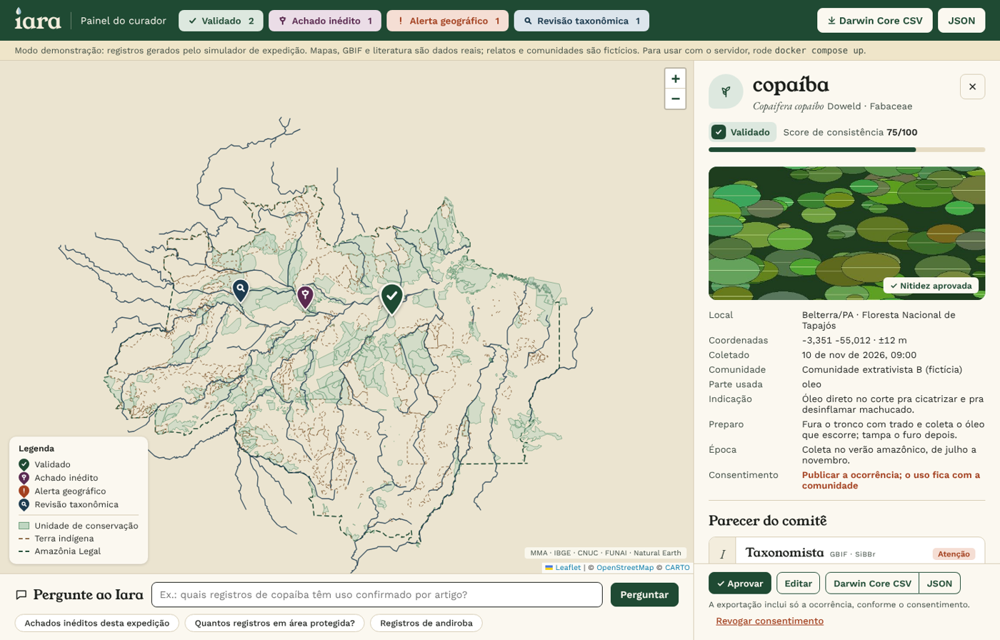
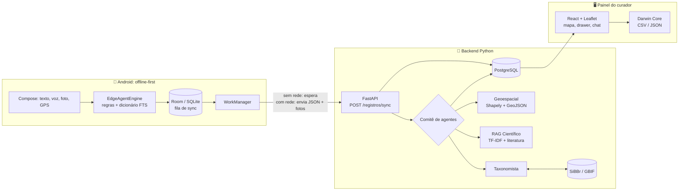

<p align="center"></p>

# Iara: Copiloto Científico de Campo

**Registro offline e validação científica de conhecimentos tradicionais da sociobiodiversidade amazônica.**

[](https://github.com/melissaalves-stack/iara-scientific-agent/actions/workflows/ci.yml)


> **Demo online do painel:** https://melissaalves-stack.github.io/iara-scientific-agent/
> (modo demonstração, com os dados gerados pelo simulador de expedição)

<p align="center"></p>

---

## O problema

Comunidades tradicionais da Amazônia guardam um conhecimento enorme sobre plantas: qual parte
usar, como preparar, para que serve, em que época coletar. Esse saber é transmitido oralmente e
se perde. Pesquisadores vão a campo para documentá-lo, mas trabalham **sem internet**, com
anotações soltas e fotos sem contexto, e depois levam semanas para organizar e conferir tudo.

## O que o Iara faz

1. **Em campo, sem internet**, o pesquisador conversa com um **agente embarcado no app
   Android**. O agente transforma o relato informal em um registro estruturado (planta, parte
   usada, preparo, indicação, época, comunidade e **consentimento**), avalia a qualidade da
   foto e registra o GPS.
2. Quando há conexão, o app **sincroniza sozinho** com o servidor.
3. No servidor, um **comitê de 3 agentes** avalia cada registro:
   - 🧬 **Taxonomista**: consulta o **SiBBr** e o **GBIF** (do qual o SiBBr é o nó brasileiro), resolve o nome científico aceito, detecta sinonímias e conta as ocorrências da espécie no Brasil.
   - 🗺️ **Geoespacial**: usa camadas oficiais para dizer município, bioma, unidade de conservação, terra indígena e rio mais próximo; consulta no GBIF se a espécie já foi registrada num raio de 100 km; e detecta erros, como latitude e longitude trocadas.
   - 📚 **RAG Científico**: compara o uso tradicional com uma base de **artigos científicos reais (com DOI)**, calcula um **Score de Consistência Científica** e sinaliza **possíveis achados inéditos**.
4. No **painel web**, o curador vê tudo num mapa, lê a conversa de campo, confere os pareceres e
   **aprova, edita ou exporta em Darwin Core**, respeitando o consentimento da comunidade.

## Arquitetura



Detalhes, modelo de dados e o porquê de cada escolha: [`docs/ARQUITETURA.md`](docs/ARQUITETURA.md).

## Requisitos atendidos

| Requisito | Onde está |
|---|---|
| App Android com funcionamento offline | [`android-field-copilot/`](android-field-copilot): Kotlin, Jetpack Compose, Room, WorkManager |
| Back-end em Python | [`backend-agents/`](backend-agents): FastAPI, SQLAlchemy, Pydantic |
| Banco de dados relacional | PostgreSQL (4 tabelas com chaves estrangeiras), [`app/models.py`](backend-agents/app/models.py) |
| Painel web | [`web-curator-panel/`](web-curator-panel): React, TypeScript, Vite, Leaflet |
| Integração com o SiBBr | [`app/services/sibbr.py`](backend-agents/app/services/sibbr.py) (serviço de espécies do SiBBr) e [`app/services/gbif.py`](backend-agents/app/services/gbif.py) (API do GBIF, rede onde o SiBBr publica) |
| Geoprocessamento | [`app/agents/geoespacial.py`](backend-agents/app/agents/geoespacial.py): Shapely com índice espacial (STRtree) sobre camadas **oficiais**: Amazônia Legal (MMA), 771 municípios (IBGE), biomas (IBGE), 351 unidades de conservação (CNUC/MMA) e 386 terras indígenas (FUNAI) |
| Inteligência artificial | Agente de campo embarcado, comitê de 3 agentes, RAG, consulta em linguagem natural |
| Padrão de dados científicos | Exportação **Darwin Core**, [`app/services/darwin_core.py`](backend-agents/app/services/darwin_core.py) |
| Ética e consentimento | Implementados no código: [`docs/ETICA_E_CONSENTIMENTO.md`](docs/ETICA_E_CONSENTIMENTO.md) |
| Testes e CI | 23 testes no backend, testes JUnit do agente de campo, GitHub Actions (backend, web e APK Android) |

## Como rodar

### Opção 1: tudo com Docker (recomendado)

Pré-requisito: [Docker Desktop](https://www.docker.com/products/docker-desktop/).

```bash
git clone https://github.com/melissaalves-stack/iara-scientific-agent.git
cd iara-scientific-agent
docker compose up --build
```

Isso sobe o PostgreSQL, a API e o painel, e roda o **simulador de expedição**, que envia
5 relatos de campo como se viessem do celular.

| O quê | Endereço |
|---|---|
| Painel do curador | http://localhost:8080 |
| API (documentação interativa) | http://localhost:8000/docs |

Para ver de novo a saída do simulador: `docker compose logs simulador`.

### Opção 2: sem Docker (para desenvolver)

```bash
# Backend (usa SQLite automaticamente)
cd backend-agents
python -m venv .venv && source .venv/bin/activate   # Windows: .venv\Scripts\activate
pip install -r requirements-dev.txt
pytest                                   # roda os testes
uvicorn app.main:app --reload            # API em http://localhost:8000

# Em outro terminal (com o mesmo ambiente ativado): simulador
python ../scripts/simulate_expedition.py

# Em outro terminal: painel
cd web-curator-panel
npm install
npm run dev                              # painel em http://localhost:5173
```

### App Android

Veja o passo a passo em [`docs/TESTAR_NO_CELULAR.md`](docs/TESTAR_NO_CELULAR.md). Resumo:
baixe o APK gerado automaticamente na aba **Actions** do GitHub, ou abra a pasta
`android-field-copilot` no Android Studio.

## O simulador de expedição

[`scripts/simulate_expedition.py`](scripts/simulate_expedition.py) faz o papel do celular:
coleta 5 relatos "offline", guarda numa fila local, envia tudo quando a "conexão volta" e
mostra o parecer do comitê. Os relatos foram escolhidos para exercitar todos os caminhos:

| Relato | Situação | Resultado esperado |
|---|---|---|
| Andiroba: óleo da semente para inchaço e repelir mosquito | Usos com artigos na base; 52 registros da espécie no GBIF em até 100 km; Resex Tapajós-Arapiuns (Santarém/PA) | ✅ Validado |
| Copaíba: óleo-resina para cicatrizar | O GBIF trata *Copaifera reticulata* como sinônimo de *C. copaibo*; comunidade autoriza publicar só a ocorrência | ✅ Validado, com aviso de sinonímia, exportado **sem** o saber tradicional |
| Unha-de-gato: chá da casca para febre | Espécie estudada (anti-inflamatório), mas não para febre; nenhum registro no GBIF em 100 km | ⭐ Achado inédito prioritário |
| Açaí | Latitude e longitude trocadas no GPS | 📍 Alerta geográfico, com sugestão de correção |
| "Pau-de-angola-do-mato" | Nome desconhecido, foto desfocada, uso interno | 🔎 Revisão taxonômica, não exportável |

## API

| Método | Rota | Para quê |
|---|---|---|
| `POST` | `/api/v1/registros/sync` | Recebe o pacote do app (multipart: `pacote` JSON + `fotos`) e dispara o comitê |
| `GET` | `/api/v1/registros` | Lista registros com pareceres e prévia Darwin Core |
| `PATCH` | `/api/v1/registros/{id}` | Curador corrige campos |
| `POST` | `/api/v1/registros/{id}/aprovar` | Curador aprova |
| `POST` | `/api/v1/registros/{id}/reprocessar` | Roda o comitê de novo (após uma correção) |
| `POST` | `/api/v1/registros/{id}/revogar-consentimento` | Comunidade retira a autorização |
| `GET` | `/api/v1/export/darwin-core?formato=csv` | Exporta a expedição em Darwin Core (CSV ou JSON) |
| `POST` | `/api/v1/copilot/query` | Pergunta em linguagem natural ("quantos achados inéditos?") |
| `GET` | `/api/v1/camadas/{nome}` | Camadas GeoJSON do mapa |

## IA opcional com LLM local

Tudo funciona **sem chave de API**, com regras e recuperação de texto. Para que o chat
analítico redija respostas com um LLM, rode o [Ollama](https://ollama.com) no computador e
descomente `LLM_BASE_URL` no `docker-compose.yml`. Qualquer API compatível com OpenAI funciona.
O LLM **nunca gera SQL**: ele só redige a resposta a partir dos dados já filtrados.

## Limitações conhecidas

Este é um MVP. Para uso científico real:

- As **camadas geográficas** são oficiais (MMA, IBGE, CNUC, FUNAI), mas simplificadas com
  tolerância de ~1 km para ficarem leves. As unidades de conservação e terras indígenas são de 2019.
- A **base de literatura** tem 13 trabalhos reais (com DOI) sobre 9 espécies. É pequena:
  "uso não documentado" significa "não documentado nesta base". Veja
  [`data/literatura/LEIA-ME.md`](backend-agents/data/literatura/LEIA-ME.md).
- O **dicionário embarcado** no app tem 10 espécies.
- **SiBBr:** o cliente usa o serviço de espécies oficial (`bie-webservice.sibbr.gov.br`),
  mas durante o desenvolvimento esse serviço não respondeu às requisições automatizadas. O
  sistema então segue para o GBIF, que respondeu normalmente. O endereço é configurável
  (`SIBBR_BIE_URL`).
- **Sem internet**, o servidor usa [`data/gbif_snapshot.json`](backend-agents/data/gbif_snapshot.json):
  respostas reais do GBIF gravadas em 15/11/2026. Com internet, consulta a API ao vivo.
- Não há autenticação de usuários.

## Próximos passos

- PostGIS para consultas espaciais com camadas oficiais grandes
- Embeddings multilíngues + pgvector para o RAG
- LLM on-device (MediaPipe) atrás da interface `ModeloLocal` já existente
- Registro do termo de consentimento e do número do SisGen
- Painel de acesso para as próprias comunidades

## Estrutura

```
iara-scientific-agent/
├── android-field-copilot/   App Android (Kotlin, Compose, Room, WorkManager)
├── backend-agents/          API FastAPI + comitê de agentes + testes
│   ├── app/agents/          taxonomista, geoespacial, rag_cientifico, comite
│   ├── app/services/        sibbr, darwin_core, consulta, texto, llm
│   └── data/                camadas GeoJSON, literatura, dicionário taxonômico
├── web-curator-panel/       Painel React + Leaflet
├── scripts/                 simulate_expedition.py + fotos de exemplo
├── docs/                    arquitetura, ética, identidade visual, teste no celular
└── docker-compose.yml
```

---

## English summary

**Iara** is an offline-first field copilot for documenting traditional ecological knowledge in
the Brazilian Amazon. An Android app (Kotlin/Compose/Room/WorkManager) runs a rule-based
on-device agent that turns informal interviews into structured records, including explicit
community consent, and syncs them when connectivity returns. A Python/FastAPI backend runs
a three-agent validation committee: taxonomy via SiBBr/GBIF, geospatial checks with Shapely,
and literature consistency via retrieval. A React/Leaflet panel lets curators review, approve
and export records as **Darwin Core**. Consent scopes are enforced in code: records are
withheld, generalized or deleted according to the community's decision.

© 2026 Melissa Hollanda de Oliveira Alves. All rights reserved. This repository is public for
portfolio purposes only; no license to use, copy or modify it is granted.

## Identidade visual

A direção **Folha-gota**: uma gota que é folha e água ao mesmo tempo, dividida pela nervura em
verde-copaíba e Rio Negro. Paleta, tipografia, regras do logo e status estão em
[`docs/IDENTIDADE_VISUAL.md`](docs/IDENTIDADE_VISUAL.md).

## Fontes dos dados geográficos

| Camada | Fonte |
|---|---|
| Limite da Amazônia Legal | Ministério do Meio Ambiente, via pacote [geobr](https://github.com/ipeaGIT/geobr) (IPEA) |
| Municípios | IBGE, via [geodata-br](https://github.com/tbrugz/geodata-br) (os 181 do Maranhão a oeste do meridiano 44°) |
| Biomas | IBGE, Biomas do Brasil 2019, via geobr |
| Unidades de conservação | CNUC/MMA, set/2019, via geobr |
| Terras indígenas | FUNAI, jul/2019, via geobr |
| Rios | [Natural Earth](https://www.naturalearthdata.com) 1:10m (domínio público) |

Cada arquivo em `backend-agents/data/geo/` traz a fonte e o processamento no campo `metadata`.

## O que é exemplo

Só o que **não pode** ser real num projeto público:

- **Relatos, pessoas e comunidades** do simulador são fictícios: relatos reais só podem ser
  publicados com o consentimento das comunidades (veja a seção de ética). As coordenadas são
  pontos reais da Amazônia.
- **Fotos do simulador** são imagens sintéticas. No app, as fotos vêm da câmera.

Todo o resto que o sistema usa para avaliar os relatos é real: mapas oficiais, nomes e
ocorrências do GBIF e artigos científicos com DOI.

## Licença

© 2026 Melissa Hollanda de Oliveira Alves. **Todos os direitos reservados.**

Este repositório é público apenas para apresentar o trabalho (portfólio). Não é permitido usar,
copiar, modificar, distribuir ou criar obras derivadas dele, no todo ou em parte, sem
autorização prévia e por escrito da autora. Veja [`LICENSE`](LICENSE).

Componentes de terceiros mantêm suas próprias licenças: fontes (SIL Open Font License), dados
do geobr/IPEA, IBGE, MMA, FUNAI, Natural Earth e GBIF (termos de cada fonte), artigos (direitos
dos autores; aqui há só resumos próprios e links) e as bibliotecas de software utilizadas.
