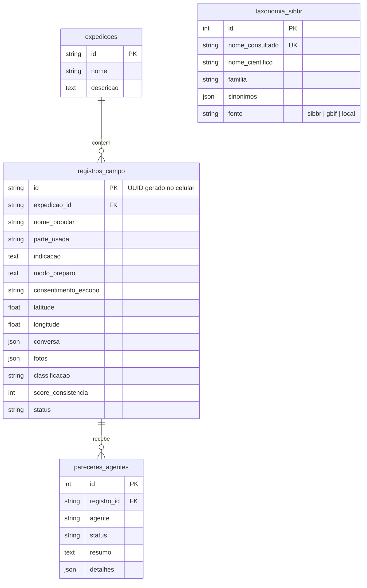
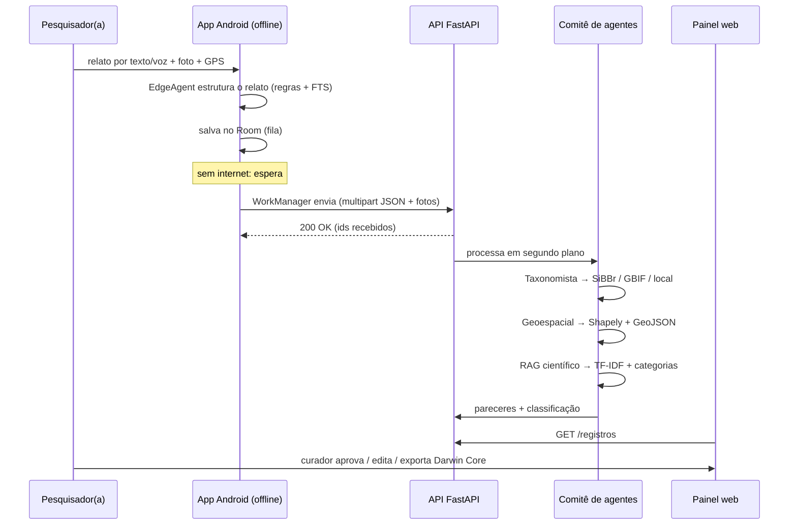

# Arquitetura e decisões técnicas

## Modelo de dados (PostgreSQL)



## Sequência de um registro



## Decisões e por quê

| Decisão | Alternativa | Motivo |
|---|---|---|
| **Id do registro gerado no celular (UUID)** | Id sequencial do servidor | Permite reenviar sem duplicar (sync idempotente), essencial com rede instável |
| **WorkManager** com restrição de rede | Service ou thread manual | Sobrevive a reinício do app/celular, espera a conexão e repete com espera crescente |
| **Room FTS4** para o dicionário | Busca com `LIKE` | Índice de palavras com busca por prefixo (`andirob*`); FTS4 é suportado nativamente pelo Room e pelo SQLite de todas as versões de Android |
| **Agente por regras (slot filling)**, LLM local opcional | LLM obrigatório no celular | Funciona em qualquer celular, sem baixar GBs de modelo, e é previsível e testável. A interface `ModeloLocal` deixa o LLM plugável (MediaPipe ou ONNX) |
| **Shapely + STRtree em Python** para validação geográfica | Consultas PostGIS | As camadas oficiais simplificadas (~2 MB) cabem na memória e a consulta leva milissegundos com índice espacial; roda igual em SQLite e PostgreSQL. Com camadas em resolução total, migrar para PostGIS (`ST_Contains`, `ST_Distance`) |
| **TF-IDF (scikit-learn)** na recuperação do RAG | Embeddings + pgvector | Corpus pequeno, sem download de modelo e explicável. Com milhares de artigos, trocar por embeddings multilíngues em pgvector |
| **Text-to-Filter** (pergunta → filtro Pydantic → SQLAlchemy) | LLM gerando SQL | Sem risco de injeção de SQL e sem consultas inventadas. O LLM, se ligado, só redige a resposta |
| **SiBBr → GBIF → dicionário local**, com cache em tabela e snapshot real do GBIF | Só SiBBr | O sistema continua funcionando com o SiBBr fora do ar ou sem internet. Testando a API real, apareceram dois casos que o código trata: o GBIF devolve o reino "Plantae" (não "não encontrado") para nomes desconhecidos, e trata *Copaifera reticulata* como sinônimo |
| **Contagem de ocorrências do GBIF num raio de 100 km** | Só verificar se o ponto está na Amazônia | Dá plausibilidade ecológica real ao registro (ex.: 52 registros de andiroba perto do relato). Zero registros não invalida: pode ser lacuna de amostragem |
| **SQLite nos testes**, PostgreSQL no compose | Postgres nos testes | Testes rápidos e sem infraestrutura; tipos usados (JSON, Float, String) funcionam nos dois |

## Score de Consistência Científica

```
score = 100 × (0,6 × usos_confirmados / usos_relatados  +  0,4 × similaridade_textual)
```

- **usos relatados**: categorias extraídas do relato ("inchaço" → anti-inflamatório).
- **usos confirmados**: os que aparecem nos documentos da mesma espécie (ou sinônimo).
- **similaridade textual**: maior similaridade TF-IDF entre o relato e um documento da espécie.

Se a espécie está na literatura, mas algum uso relatado não está, o registro vira
**achado inédito prioritário** (para revisão humana).

## Classificação final

Avaliada nesta ordem:
1. Coordenada fora da Amazônia Legal → **Alerta geográfico**
2. Táxon não encontrado → **Revisão taxonômica**
3. Uso não documentado ou espécie sem literatura → **Achado inédito prioritário**
4. Caso contrário → **Validado**
